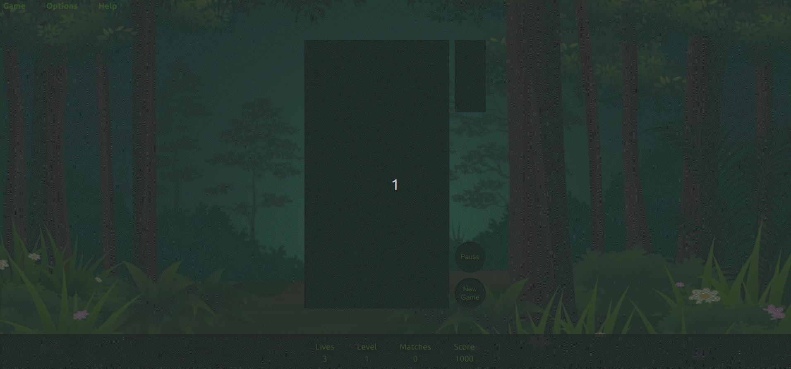

<h1 align="center">Michael is On The Road...</h1>

<h3 align="center">Born 🇦🇺 => Studied 🇬🇧 => Settled 🇨🇦</h3>
 

Working at <a href="https://transistor.fm/" target="_blank">Transistor.fm</a>

<section align="center">
<h2>Projects</h2>
<table bordercolor="#66b2b2">
  <tr>  
    <td width="100%" valign="top">
      <h3>Forest Friends</h3>

  

    
      

        
<strong>JavaScript, HTML (canvas), CSS</strong> – A personal homage to the Macintosh game Jewelbox (1992) and Sega Columns (1990) built using the canvas element.

    </td>
  </tr>
</table>
</section>

 

<section align="center">
<h2>Profile Visits</h2> 

</section>
